<a href="https://kooroshrh.github.io/">
  <picture>
    <source media="(prefers-color-scheme: dark)" srcset="assets/header-dark.svg">
    <source media="(prefers-color-scheme: light)" srcset="assets/header-light.svg">
    
  </picture>
</a>

  
  
  
  
  
  

### 🧭 About me

- 🎓 PhD candidate at the **University of Toronto** and Faculty Affiliate Researcher at the **Vector Institute**.
- 🔬 I push diffusion transformers **beyond their training resolution**, with attention that adapts as an image is denoised.
- ⚡ I like methods that are **training-free and model-agnostic**: drop them into FLUX, Qwen-Image or Ideogram and get larger, sharper images, often faster.
- 🧩 I've also built computer-vision systems for pose estimation, gait recognition and action recognition.
- 🛠️ I care about research code people can actually run: clean, reproducible and open source.
- 💬 Ask me about high-resolution synthesis, attention mechanisms and diffusion models. I'm open to research collaborations.

### 📄 Recent work

| Paper | Venue | Links |
| :--- | :---: | :--- |
| **[AReA](https://github.com/KooroshRH/AReA)** &nbsp; Adaptive Receptive-Field Attention for Efficient High-Resolution Diffusion Transformers | Preprint | [Paper](https://arxiv.org/abs/2610.17227) · [Project](https://rajabi2001.github.io/area/) · [Demo](https://huggingface.co/spaces/kooroshrh/AReA) |
| **[SEGA](https://github.com/rajabi2001/sega)** &nbsp; Spectral-Energy Guided Attention for Resolution Extrapolation in Diffusion Transformers | NeurIPS&nbsp;2026 | [Paper](https://arxiv.org/abs/2605.22668) · [Project](https://rajabi2001.github.io/sega/) |
| **[PhotoQuilt](https://github.com/KooroshRH/PhotoQuilt)** &nbsp; Training-Free Arbitrary-Resolution Photomosaics via Bootstrapped Tiled Denoising | WACV&nbsp;2027 | [Paper](https://arxiv.org/abs/2606.30968) · [Project](https://kooroshrh.github.io/photo-quilt/) |

### 🛠️ Toolbox

  <picture>
    <source media="(prefers-color-scheme: dark)" srcset="https://skillicons.dev/icons?i=py,pytorch,tensorflow,opencv,sklearn,c,java,kotlin,go,androidstudio,linux,bash,git,latex&theme=dark">
    <source media="(prefers-color-scheme: light)" srcset="https://skillicons.dev/icons?i=py,pytorch,tensorflow,opencv,sklearn,c,java,kotlin,go,androidstudio,linux,bash,git,latex&theme=light">
    
  </picture>

### 📈 GitHub activity

<!-- These cards are rebuilt daily by .github/workflows/profile-cards.yml and published to the `output` branch. -->

  <picture>
    <source media="(prefers-color-scheme: dark)" srcset="https://raw.githubusercontent.com/KooroshRH/KooroshRH/output/stats-dark.svg">
    <source media="(prefers-color-scheme: light)" srcset="https://raw.githubusercontent.com/KooroshRH/KooroshRH/output/stats-light.svg">
    
  </picture>
  <picture>
    <source media="(prefers-color-scheme: dark)" srcset="https://raw.githubusercontent.com/KooroshRH/KooroshRH/output/top-langs-dark.svg">
    <source media="(prefers-color-scheme: light)" srcset="https://raw.githubusercontent.com/KooroshRH/KooroshRH/output/top-langs-light.svg">
    
  </picture>

  <picture>
    <source media="(prefers-color-scheme: dark)" srcset="https://raw.githubusercontent.com/KooroshRH/KooroshRH/output/streak-dark.svg">
    <source media="(prefers-color-scheme: light)" srcset="https://raw.githubusercontent.com/KooroshRH/KooroshRH/output/streak-light.svg">
    
  </picture>

  <picture>
    <source media="(prefers-color-scheme: dark)" srcset="https://raw.githubusercontent.com/KooroshRH/KooroshRH/output/snake-dark.svg">
    <source media="(prefers-color-scheme: light)" srcset="https://raw.githubusercontent.com/KooroshRH/KooroshRH/output/snake-light.svg">
    
  </picture>

